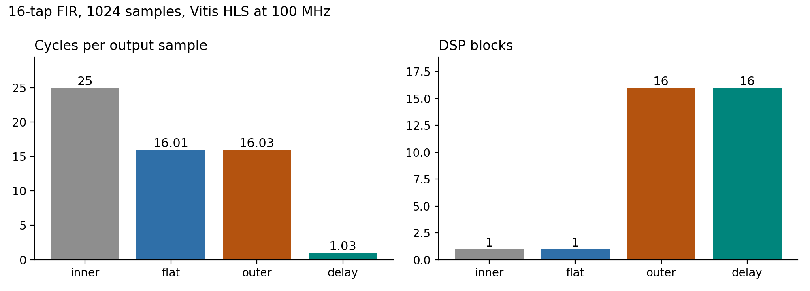
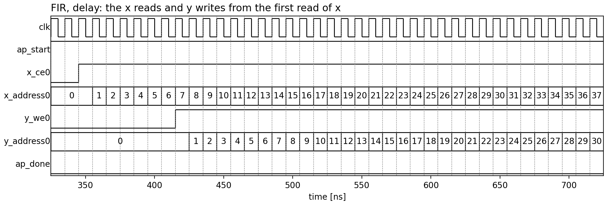

# The Results

`results/fir.md`, Vitis HLS 2025.1 on the Zynq-7020 at 100 MHz, for a full
call of 1024 samples:

| Variant | Pipelined loop | II | Trip count | Iteration latency | Cycles, 1024 samples | Cycles / sample | DSP | FF | LUT |
|---|---|---|---|---|---|---|---|---|---|
| inner | tap_loop | 1 | 16 | 5 | 25601 | 25.0 | 1 | 182 | 305 |
| flat | sample_loop_tap_loop | 1 | 16384 | 7 | 16391 | 16.01 | 1 | 326 | 518 |
| outer | sample_loop | 16 | 1024 | 22 | 16412 | 16.03 | 16 | 1584 | 1156 |
| delay | sample_loop | 1 | 1024 | 8 | 1053 | 1.03 | 16 | 1832 | 710 |

and `results/fir.png`:



## `inner`: the cost of restarting a pipeline

The report's loop table has two rows for `inner`:

```text
|- sample_loop  |       25|    25600|        25|          -|          -|  1 ~ 1024|        no|
 + tap_loop     |       19|       19|         5|          1|          1|        16|       yes|
```

The tap loop does reach II = 1: 16 taps in 19 cycles, a new tap every cycle
and a few more for the last one to get through its 5-cycle pipeline. But the sample loop is not
pipelined, so it runs the tap loop **1024 times, one after another**, and
each time adds 6 cycles to enter it, to clear `acc` and to write `y[n]`: 25
cycles per sample, of which 16 do any multiplying. One multiplier, busy 64%
of the time.

## `flat`: let Vitis flatten the nest

Remove `LOOP_FLATTEN off`, and the two rows become one:

```text
|- sample_loop_tap_loop  |       21|    16389|         7|          1|          1|  16 ~ 16384|       yes|
```

Vitis merged the two loops into one of 1024 × 16 = 16384 iterations and
pipelined it once, so the pipeline is filled and drained **once per call**
instead of once per sample. 16 cycles per sample: the multiplier is busy
every cycle.

Vitis flattens a nest when it can: when the inner loop has a constant trip
count and the code between the two loops can be folded into the inner one
as conditions (`acc = 0` when `k == 0`, the write when `k == 15`). That is
why the obvious code is already reasonable. But it is still **one tap per
cycle**: 16 cycles per sample is the best a single multiplier can do.

## `outer`: unrolled, and starved by the memory

Pipelining the sample loop instead unrolls the tap loop: 16 multipliers, 16
DSPs. If each iteration started a cycle after the last, that would be one
sample per cycle. The report says II = 16, and the synthesis log,
`results/synth/vitis.log`, says why:

```text
WARNING: [HLS 200-885] The II Violation in module 'fir_Pipeline_sample_loop' (loop 'sample_loop'):
Unable to schedule 'load' operation 16 bit ('x_load_11', fir.cpp:69) on array 'x' due to limited
memory ports (II = 1). Please consider using a memory core with more ports or partitioning the array 'x'.
```

Vitis tried II = 1, 2, 3, ... up to 15, and settled on 16. Each iteration
reads 16 samples of `x`, and the memory delivers one per cycle. The result
is as slow as `flat`, with **16 times the multipliers**, each idle 15
cycles out of 16. It is the memory bottleneck of
[unrolling the cubic](../loopopt/unroll.md#without-partitioning-no-faster-at-all)
again, with the unrolling done by the pipeline pragma.

Partitioning `x` cyclically by 16 would work: the 16 samples an iteration
needs, `x[n-15]` to `x[n]`, are consecutive, so they are always in 16
different memories. But that is 16 memories, and since `x` is an argument,
whatever calls the IP has to supply all 16. Each sample would still be read
16 times. The cheaper fix is to stop reading them.

## `delay`: read each sample once

The delay line reads one sample per iteration and keeps the other 15 in
registers: II = 1, **1053 cycles** for 1024 samples, 16 times fewer than
`flat` and `outer`. The same 16 DSPs as `outer`, now busy every cycle.
The registers cost a few hundred flip-flops more; the LUTs go down, since
there are no longer 16 addresses to compute.

The co-simulation, `results/timing_delay.png`, from the first read of `x`:



- `x_address0` steps **one address per cycle**: one read per sample.
- Seven cycles after the first read, `y_we0` goes high and stays high:
  one output per cycle, from then on.
- Co-simulation measured 1049 cycles for the call and checked every output
  against the Python model.

## What to take away

| | Cycles per sample | Multipliers | Busy |
|---|---|---|---|
| `inner`: tap loop pipelined, not flattened | 25 | 1 | 64% |
| `flat`: tap loop pipelined, flattened | 16 | 1 | 100% |
| `outer`: sample loop pipelined, 16 reads per sample | 16 | 16 | 6% |
| `delay`: sample loop pipelined, delay line | 1 | 16 | 100% |

- Pipelining an **inner** loop pays its fill and drain once per outer
  iteration, unless the nest is flattened. Vitis flattens when it can.
- Pipelining an **outer** loop unrolls the loops inside it: that is how to
  get more than one inner iteration per cycle, and it costs hardware for
  each.
- The unrolled inner loop then needs its data in parallel. A **delay line**
  turns 16 reads per sample into one, by keeping the data that the next
  iterations will reuse.
