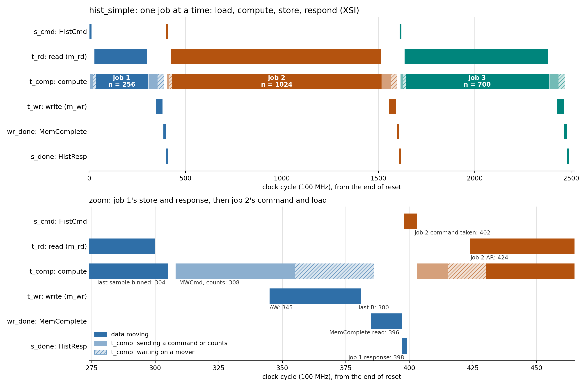

# hist_simple: One Job at a Time

This is the unit 9 design. The command arrives on an AXI4-Stream, `s_cmd`, and the response
leaves on another, `s_done`. The samples and counts are in memory, reached through two AXI4
master ports: `m_rd` for reading and `m_wr` for writing. Between them are three tasks: one
compute task, which does all the thinking, and two of Waveflow's data movers, which only move
words.

```
s_cmd -> +---------+ -MRCmd-> mem_r_stream (m_rd) -samples-+
         |         | <-------------------------------------+
         | compute |
         |         | -MWCmd + counts-> mem_w_stream_done (m_wr) -+
s_done <-+---------+ <-------------- MemComplete ----------------+
```

The compute task handles **one job per firing, start to finish**: it reads the command, has the
read mover load the samples, bins them, has the write mover store the counts, waits until the
memory has acknowledged them, and responds. Only then does it read the next command. Nothing
overlaps across jobs, which is what makes every step of a transaction visible in the
waveform. [Unit 10](pipeline.md) removes the idle time this costs.

## The top

```cpp
void hist_simple(hls::stream<word_t>& s_cmd, const word_t* m_rd, word_t* m_wr,
                 hls::stream<word_t>& s_done) {
#pragma HLS INTERFACE axis port=s_cmd
#pragma HLS INTERFACE m_axi port=m_rd offset=off bundle=gmem0 depth=65536
#pragma HLS stable variable=m_rd
#pragma HLS INTERFACE m_axi port=m_wr offset=off bundle=gmem1 depth=65536
#pragma HLS stable variable=m_wr
#pragma HLS INTERFACE axis port=s_done
#pragma HLS INTERFACE ap_ctrl_none port=return
    hls_thread_local hls::stream<word_t> rd_cmd, rd_data, wr_cmd, wr_data, wr_done;

    hls_thread_local hls::task t_rd(mem_r_stream_task<MEM_DW>, rd_cmd, m_rd, rd_data);
    hls_thread_local hls::task t_comp(hist_compute, s_cmd, s_done,
                                      rd_cmd, rd_data, wr_cmd, wr_data, wr_done);
    hls_thread_local hls::task t_wr(mem_w_stream_done_task<MEM_DW>, wr_cmd, wr_data, m_wr, wr_done);
}
```

- **`ap_ctrl_none`**: no start or done signal. The kernel never stops; each task is
  **re-fired** by the runtime whenever its input arrives.
- **Three `hls::task`s**, joined by five `hls_thread_local` FIFOs of the default depth, 2.
  Nothing deeper is needed: each message is read as fast as it is written.
- **`m_axi` with `offset=off` and `stable`**: the only form in which Vitis supports a memory
  pointer passed to an `hls::task`. There is no base-address register: the bus address is the
  command's word offset times 4, from address 0.
- **Two bundles**, `gmem0` and `gmem1`: one read owner and one write owner. On the board both
  would reach the same DRAM, and the testbench serves both from one memory.

## The compute task

```cpp
static void hist_compute(hls::stream<word_t>& s_cmd, hls::stream<word_t>& s_done,
                         hls::stream<word_t>& rd_cmd, hls::stream<word_t>& rd_data,
                         hls::stream<word_t>& wr_cmd, hls::stream<word_t>& wr_data,
                         hls::stream<word_t>& wr_done) {
    HistCmd cmd;
    cmd.read_stream<MEM_DW>(s_cmd);
    HistResp resp;
    resp.job_id = cmd.job_id;
    resp.status = (cmd.n <= MAX_N) ? HistStatus::OK : HistStatus::N_TOO_LARGE;

    if (resp.status == HistStatus::OK) {        // a refused job touches no memory
        MRCmd rc;                               // load: n samples from data_addr
        rc.addr = cmd.data_addr;
        rc.len = cmd.n;
        rc.xfer_len = 0;                        // no tag (unit 10 uses one)
        rc.write_stream<MEM_DW>(rd_cmd);

        count_t counts[NBINS];
#pragma HLS ARRAY_PARTITION variable=counts complete
    CLEAR: for (int b = 0; b < NBINS; b++) {
#pragma HLS UNROLL
            counts[b] = 0;
        }
    SAMPLES: for (int i = 0; i < (int)cmd.n; i++) {       // compute
#pragma HLS PIPELINE II=1
            const word_t bin = rd_data.read() >> cmd.shift;
            counts[bin < NBINS ? (int)bin : NBINS - 1]++;
        }

        MWCmd wc;                               // store: NBINS counts to cnt_addr
        wc.addr = cmd.cnt_addr;
        wc.len = NBINS;
        wc.xfer_len = 0;
        wc.write_stream<MEM_DW>(wr_cmd);
    COUNTS: for (int b = 0; b < NBINS; b++) {
#pragma HLS PIPELINE II=1
            wr_data.write(counts[b]);
        }

        MemComplete done;                       // wait: the counts are in memory
        done.read_stream<MEM_DW>(wr_done);
    }
    resp.write_stream<MEM_DW>(s_done);
}
```

Read it as the five steps of a transaction:

1. **Command.** Read the `HistCmd` and decide the status. A job with `n > MAX_N` is refused: it
   sends no memory command at all, so it does no memory traffic, and still gets its response.
2. **Load.** One `MRCmd` to the read mover: `n` words from word `data_addr`.
3. **Compute.** Bin exactly `n` samples as they arrive on `rd_data`.
4. **Store.** One `MWCmd` to the write mover, then the 32 counts on `wr_data`.
5. **Wait, then respond.** Read the write mover's `MemComplete`, which it sends only after the
   memory has acknowledged the last write, then send the `HistResp`.

**The loop-carried dependence.** `counts[bin]++` reads a count, adds one and writes it back.
If the next sample lands in the same bin, its read must see this write, so a new sample can
start every cycle only if read, add and write fit in one cycle. With the counts partitioned
into 32 registers they do: Vitis schedules `SAMPLES` at **II=1** (iteration latency 5).

**The tag is not used.** `MRCmd` and `MWCmd` carry an `xfer_msg` tag, up to eight words that the
write mover hands back in its `MemComplete`. Here `xfer_len` is 0: the compute task waits for
each completion before issuing anything else, so it always knows which job a completion
belongs to. Unit 10, where several jobs are in flight at once, uses the tag (see
[messages and serialization](messages.md#an-xfer_msg-tag-matches-the-completion-to-its-job)).

## The data movers

The two memory tasks are Waveflow's plain movers, used as they are:

- `mem_r_stream_task<32>`: read one `MRCmd`, then burst `len` words from `m_rd[addr]` onto
  `rd_data`, one per cycle.
- `mem_w_stream_done_task<32>`: read one `MWCmd`, write `len` words from `wr_data` to
  `m_wr[addr]`, wait for the memory's last write response, then send one `MemComplete` on
  `wr_done`. An `hls::fence` between the write loop and the completion orders the two: without
  it, Vitis sends the completion while it is still waiting for the write response.

Each owns one `m_axi` port and touches nothing else but streams. That split is a rule, not a
style: a task that owns a memory port should do nothing but move words, so the task that holds
state never waits on the bus, and two tasks never share one port.

## The messages

All words are 32 bits, and every address is a **word offset**, not a byte address. Every
message is a generated struct, written and read with its generated `write_stream` /
`read_stream`; nothing is packed by hand.

| Message | Stream | Words | Fields |
| --- | --- | --- | --- |
| `HistCmd` | `s_cmd` | 5 | `job_id`, `data_addr`, `n`, `cnt_addr`, `shift` |
| `MRCmd` | `rd_cmd` | 11 | `addr`, `len`, `xfer_len`, `xfer_msg[8]` |
| `MWCmd` | `wr_cmd` | 11 | `addr`, `len`, `xfer_len`, `xfer_msg[8]` |
| `MemComplete` | `wr_done` | 10 | `len`, `xfer_len`, `xfer_msg[8]` |
| `HistResp` | `s_done` | 2 | `job_id`, `status` (`OK` = 0, `N_TOO_LARGE` = 1) |

`HistCmd` and `HistResp` are declared in `hist_schema.py`; `MRCmd`, `MWCmd` and `MemComplete`
are Waveflow's. The three mover messages always carry all eight tag words, used or not. How a
message is declared and generated is on the [messages and serialization](messages.md) page.

## How it is checked

Five jobs:

| Job | `n` | `shift` | Samples | Expected |
| --- | --- | --- | --- | --- |
| 1 | 256 | 11 | uniform over 16 bits | `OK` |
| 2 | 1024 | 11 | a bell curve | `OK` |
| 3 | 700 | 10 | uniform; half saturate the top bin | `OK` |
| 4 | 70000 | 11 | none: `n > MAX_N` | `N_TOO_LARGE`, nothing written |
| 5 | 1024 | 11 | a decaying exponential | `OK` |

`hist_build.py` runs them three times:

1. **C simulation** (Vitis `csim`). The testbench pushes all five commands, calls the top once,
   and reads five responses: the tasks run as threads.
2. **RTL simulation through XSI**, twice. Vitis co-simulation of an `ap_ctrl_none` design is not
   reliable, so the synthesized Verilog is driven directly, cycle by cycle, with Waveflow's
   bus models: a stream master on `s_cmd`, an AXI4 read slave on `m_axi_gmem0` and a write
   slave on `m_axi_gmem1` over one memory, and a stream slave on `s_done`. Once with the five
   commands back to back, once with each job alone (1500 idle cycles between commands).

After each run, every count is compared with NumPy's `bincount`, the refused job's counts
must be untouched, and there must be exactly five responses, in order, with the right status.
A deadlock would show up as a missing response, never as a pass. All three runs pass.

Vitis schedules `SAMPLES`, `COUNTS` and the movers' `A2S` / `S2A` at II=1, and estimates the
design at **137 MHz** (FF 3319, LUT 4512, BRAM 2, DSP 0), against 111 MHz for `hist_pipeline`,
whose framed movers have the slowest paths.

## The timing of a job

From the waveform, in clock cycles (100 MHz) after the command's last word was accepted. The
numbers are the same back to back and with each job alone:

| `n` | AR | first sample (L) | last sample | MWCmd issued | AW | last count | last B | MemComplete read | response |
| --- | --- | --- | --- | --- | --- | --- | --- | --- | --- |
| 256 | 22 | 23 | 293 | 302 | 339 | 349 | 374 | 390 | 392 |
| 1024 | 22 | 23 | 1109 | 1118 | 1155 | 1165 | 1190 | 1206 | 1208 |
| 700 | 22 | 23 | 765 | 774 | 811 | 821 | 846 | 862 | 864 |
| 70000 (refused) | - | - | - | - | - | - | - | - | 4 |

"Last sample" is the last read beat on the bus; "last count" is the compute task's last count
on `wr_data`; "MWCmd issued" its first word; "MemComplete read" the completion's last word.
Reading the `n` = 256 row in full:

| Cycles after the command | What |
| --- | --- |
| 1 to 13 | the compute task writes the 11-word `MRCmd` |
| 22 | the read mover's first read request (`AR`) |
| 23 to 293 | 256 samples on the bus: 16 bursts of 16, 17 cycles each |
| 28 to 298 | the compute task bins them, one per cycle, 5 behind the bus |
| 302 to 314 | the 11-word `MWCmd` |
| 317 to 349 | the 32 counts on `wr_data` |
| 339, 373 | the first write request (`AW`), the last write beat (`W`) |
| 374 | the last write response (`B`): the counts are in memory |
| 379 to 390 | the 10-word `MemComplete`, after the write mover's fence |
| 391 to 392 | the 2-word `HistResp` |

- **L = 23 cycles** to the first sample, for every size: mostly the 11-word read command.
- **The write request goes out before the last count** (339 against 349): the write port asks
  for a 16-beat burst once it has the first 16 counts.
- **The response leaves 18 cycles after the counts are in memory**: 5 for the fence, 12 for
  the completion's 10 words, then the response.
- A refused job answers in **4 cycles** and never touches memory.

## No overlap across jobs



One row per task or channel, one colour per job. Each job runs **load, compute, store, respond**,
and the next job's command is taken only after that response: job 1 responds at cycle 398 and
job 2's command is taken at 402, its read request at 424. So while the counts are written and
acknowledged the read port is idle, and while the samples are read the write port is idle.
Between job 1's last sample and job 2's first, the read port waits 125 cycles.

| | `hist_simple` | `hist_pipeline` |
| --- | --- | --- |
| all five back to back: last response | cycle 3699 | cycle 3369 |
| back to back: first command word to last response word | 3698 | 3368 |
| the same jobs alone, each first command word to last response word, added up | 3702 | 3612 |
| saved by running back to back | 4 | 244 |

Back to back, `hist_simple` saves only the 4 cycles the `s_cmd` port's register slice gains by
taking the next command's first words early. `hist_pipeline` saves 244, because its read port
starts the next job while this one computes and writes.

## What the testbench's memory hides

The memory model answers a read request on the next cycle and serves one burst at a time. A
DRAM behind an interconnect takes tens of cycles to answer, but accepts several requests at
once. So on the board `L` and the time from the last write to its `B` would be longer, and the
idle time between jobs with them, while the one idle cycle per 16-word read burst would
disappear.
