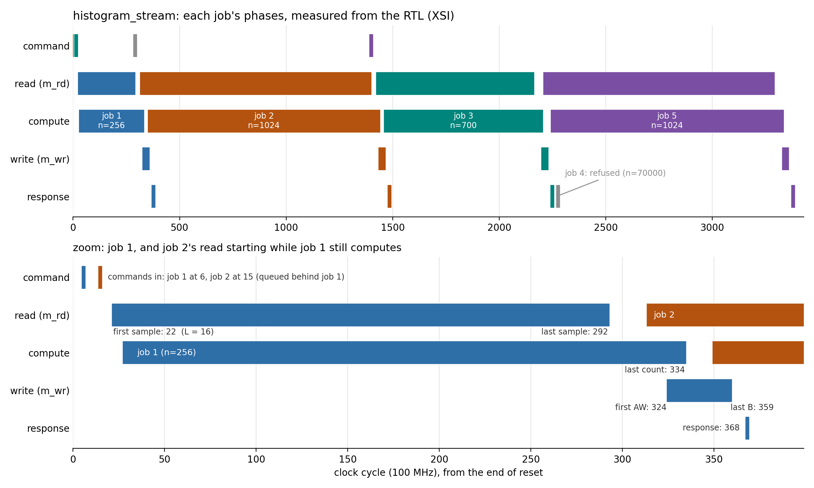

# The Stream Version

In this version the command arrives on an AXI4-Stream, `s_cmd`, and the response leaves on
another, `s_done`. The samples and counts are in memory, reached through two AXI4 master
ports: `m_rd` for reading and `m_wr` for writing.

## The top

```cpp
void histogram_stream(hls::stream<word_t>& s_cmd, const word_t* m_rd, word_t* m_wr,
                      hls::stream<word_t>& s_done) {
#pragma HLS INTERFACE axis port=s_cmd
#pragma HLS INTERFACE m_axi port=m_rd offset=off bundle=gmem0 depth=65536
#pragma HLS stable variable=m_rd
#pragma HLS INTERFACE m_axi port=m_wr offset=off bundle=gmem1 depth=65536
#pragma HLS stable variable=m_wr
#pragma HLS INTERFACE axis port=s_done
#pragma HLS INTERFACE ap_ctrl_none port=return
    static const int HDR = MemWCmd::nwords<MEM_DW>() + HistDesc::nwords<MEM_DW>();
    hls_thread_local hls::stream<frame_t, 2 * HDR> rd_cmd, rd_data, wr_data;
    hls_thread_local hls::stream<word_t> wr_done;

    hls_thread_local hls::task t_ctrl(hist_control, s_cmd, rd_cmd);
    hls_thread_local hls::task t_rd(mem_r_stream_framed_task<MEM_DW>, rd_cmd, m_rd, rd_data);
    hls_thread_local hls::task t_comp(hist_compute, rd_data, wr_data);
    hls_thread_local hls::task t_wr(mem_w_stream_framed_done_task<MEM_DW, HistDesc::nwords<MEM_DW>()>,
                                    wr_data, m_wr, wr_done);
    hls_thread_local hls::task t_resp(hist_response, wr_done, s_done);
}
```

- **`ap_ctrl_none`**: no start or done signal. The kernel never stops; each task is
  **re-fired** by the runtime whenever its input arrives.
- **One `hls::task` per task**, joined by `hls_thread_local` FIFOs, in a line: each task has
  one input and one output, apart from the movers' memory ports.
- **The framed FIFOs hold 16 words**, two whole headers (a 3-word memory command and the 5-word
  descriptor). The depth comes from the generated `nwords<MEM_DW>()`, never from a literal. It
  matters most on `rd_data`: see [below](#do-consecutive-jobs-overlap).
- **`m_axi` with `offset=off` and `stable`**: the only form in which Vitis supports a memory
  pointer passed to an `hls::task`. There is no base-address register: the bus address is the
  command's word offset times 4, from address 0. With `offset=slave`, Vitis would add a hidden
  FIFO of pointers for each task, and a design whose tasks fire different numbers of times per
  job deadlocks on it, at RTL only.
- **Two bundles**, `gmem0` and `gmem1`: one read owner and one write owner. On the board both
  would reach the same DRAM, and the testbench serves both from one memory.

Vitis schedules both data loops, `SAMPLES` and the movers' `A2S` / `S2A`, at II=1, and
estimates the design at 111 MHz. The slowest module is Waveflow's framed read mover (8.98 ns of
the 10 ns clock).

## How it is checked

Five jobs, sent back to back:

| Job | `n` | `shift` | Samples | Expected |
| --- | --- | --- | --- | --- |
| 1 | 256 | 11 | uniform over 16 bits | `OK` |
| 2 | 1024 | 11 | a bell curve | `OK` |
| 3 | 700 | 10 | uniform; half saturate the top bin | `OK` |
| 4 | 70000 | 11 | none: `n > MAX_N` | `N_TOO_LARGE`, nothing written |
| 5 | 1024 | 11 | a decaying exponential | `OK` |

`hist_build.py` runs them twice:

1. **C simulation** (Vitis `csim`). The testbench pushes all five commands, calls the top once,
   and reads five responses: the tasks run as threads. It works, and takes about 15 seconds,
   so it is the quick check while writing a task.
2. **RTL simulation through XSI.** Vitis co-simulation of an `ap_ctrl_none` design is not
   reliable, so the synthesized Verilog is driven directly, cycle by cycle, with Waveflow's
   bus models: a stream master on `s_cmd`, an AXI4 read slave on `m_axi_gmem0` and a write
   slave on `m_axi_gmem1` over one memory, and a stream slave on `s_done`. It runs twice:
   with the five commands back to back, and with each job alone (1500 idle cycles between
   commands).

After each run, every count is compared with NumPy's `bincount`, the refused job's counts
must be untouched, and there must be exactly five responses, in order, with the right status.
A deadlock would show up as a missing response, never as a pass. All three runs pass.

## The timing of a job

From the waveform of the run with each job alone, in clock cycles (100 MHz) after the
command's last word was accepted:

| `n` | first sample (L) | last sample | last count | first write request | last write ack (B) | response |
| --- | --- | --- | --- | --- | --- | --- |
| 256 | 16 | 286 | 328 | 318 | 353 | 362 |
| 1024 | 16 | 1102 | 1144 | 1134 | 1169 | 1178 |
| 700 | 16 | 758 | 800 | 790 | 825 | 834 |
| 70000 (refused) | - | - | - | - | - | 34 |

Reading one row, `n` = 256, in absolute cycles (the command's last word is at cycle 6):

- **Latency to the first sample, L = 16 cycles**, the same for every size. Most of it is the
  command path, not the memory. The control task writes 8 words: the 3-word `MemRCmd` and the
  5-word descriptor (cycles 4 to 11). The read mover reads the command (5 to 7), relays the
  descriptor (9 to 13), and issues the read request 8 cycles later (21). The testbench's memory
  answers on the next cycle (22).
- **The read**: 256 samples from cycle 22 to 292. The read mover asks for 16 words at a time
  (`ARLEN` = 15), and the testbench's memory serves one burst at a time, so each burst of 16
  takes 17 cycles: 16 burst requests for 256 samples, 64 for 1024. (Job 5's 1024 samples
  take one cycle longer: they start at word 1980 and cross a 4 KB boundary at word 2048,
  which no AXI burst may cross, so the mover splits one burst in two.)
- **The compute** has the descriptor at cycle 14, and has sent the write command and the
  descriptor on to the write mover by cycle 21, before the first sample. It starts binning 5
  cycles after the first sample and keeps pace with the read, one sample per cycle, then writes
  its 32 counts: the last at cycle 334, 42 after the last sample.
- **The write**: 32 counts in two bursts of 16. The write mover's first request goes out
  before the compute is done (cycle 324), as soon as it has buffered a burst; the memory
  acknowledges the last burst at cycle 359.
- **The response** leaves at cycle 368, 9 after the last acknowledgement. Its makeup is
  [below](#the-response-and-the-write-acknowledgement).

A refused job never touches memory: its read has length 0 and issues no bus request, and its
write has length 0. Its descriptor still goes through every task, and its response comes 34
cycles after its command.



## Do consecutive jobs overlap?

Yes. The top of the figure is the back-to-back run. The control task accepts the next command
as soon as it has framed this one's, so job 2's read command and descriptor are already queued
when job 1's read finishes. Job 2's read starts at cycle 313, while job 1 is still computing its
counts (last at 334), writing them (to 359) and sending its response (368): the end of each job
hides behind the start of the next.

That overlap depends on the depth of `rd_data`. Job 2's descriptor has to get past the end of
job 1's samples before the read mover can issue job 2's read, and while the compute task is
still writing job 1's counts, nobody takes words off `rd_data`. With the default depth of 2,
the read mover stalled after two words of the descriptor, and job 2's read waited until
job 1's compute was done (cycle 346, not 313). A FIFO that carries headers must hold a whole
header.

The **read port** is the bottleneck. It is busy from one job's first sample to its last, then
idle for 21 cycles while the read mover takes its next command, relays its descriptor and
issues the first request; the compute task follows it sample for sample. All five jobs finish
at cycle 3369, against 3587 for the same jobs one at a time.

## The response and the write acknowledgement

A job is done when its counts are in memory, and the memory says so with the write response
(`B`) of the last burst. The write mover sends the descriptor back only after that response:
an `hls::fence` between its write loop and its echo orders the two. Without the fence, Vitis
sends the echo while it is still waiting for `B`, and the response would leave before the
counts are known to have landed.

For `n` = 256, from the last `B` at cycle 359 (absolute):

| Cycles | What |
| --- | --- |
| 359 to 365 | the fence: the write mover sees `B` and starts the echo |
| 365 to 369 | the 5-word descriptor to the response task |
| 366 to 368 | the response task reads it and sends the 2-word `HistResp` |

So the response leaves 9 cycles after the counts are in memory, every time. The response task
needs only the first two words of the descriptor, `job_id` and `status`, so its `HistResp`
goes out while the last words of the descriptor are still arriving.

## What the testbench's memory hides

The memory model answers a read request on the next cycle and serves one burst at a time. A
DRAM behind an interconnect takes tens of cycles to answer, but accepts several requests at
once. So on the board `L` would be longer, while the one idle cycle per 16-word burst would
disappear.
