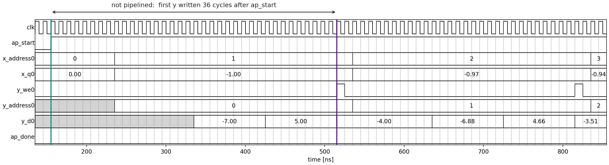
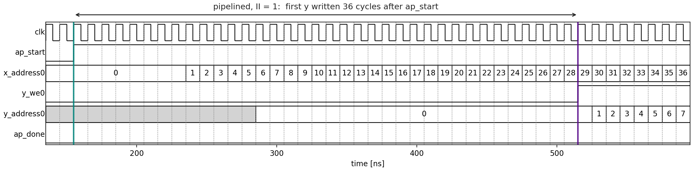

# Pipelining the Loop

This page builds two variants of the [kernel](kernel.md), the sample loop
with pipelining switched off and the same loop with
`#pragma HLS PIPELINE II=1`, and compares them: first in the synthesis
reports, then in RTL simulation.

## Pre-requirements

You will need the [software set-up](../../support/amd/) for Vitis and
Python. Run everything below from `hwdesign/demos/pipeline/poly`, in the
environment with `waveflow` (`hwdesign-venv`).

## The build script

`poly_build.py` runs each tool in turn and checks the results in between.
List its steps with:

```bash
(env) python poly_build.py --list-steps
```

Part 1 is these steps:

```
make_inputs -> csim -> verify_csim -> synth_pipe -> pipe_report ------------------------------------------> pipeline
                                                 -> schedule_pipe
                                                 -> cosim_nopipe -> verify_cosim_nopipe -> vcd_nopipe -> timing_nopipe
                                                 -> cosim_pipe -> verify_cosim_pipe -> vcd_pipe -> timing_pipe
```

Run them all with:

```bash
(env) python poly_build.py --through pipeline
```

It takes a few minutes, most of it the two co-simulations. A step is
skipped when nothing it depends on has changed, so running the same
command again does nothing.

## Step 1: C simulation (`make_inputs`, `csim`, `verify_csim`)

`make_inputs` writes the test vector and the expected results from
`golden.py`. `csim` compiles the testbench against the C++ function and
runs it:

```text
64 samples, 0 mismatches.
Wrote .../results/csim/results.json
All tests passed.
```

`verify_csim` then compares the bit pattern of every `y` with the Python
model's. C simulation runs the C++ as software, so the pragmas make no
difference to it: one run covers every variant.

## Step 2: C synthesis (`synth_pipe`)

`synth_pipe` synthesizes the two variants, each into its own project:

- `proj_nopipe`: `#pragma HLS PIPELINE off`
- `proj_pipe`: `#pragma HLS PIPELINE II=1`

both for a 10 ns clock (100 MHz) on the PYNQ-Z2's FPGA. For each one,
`run.tcl` comes down to:

```tcl
open_project -reset proj_pipe
set_top poly
add_files poly.cpp -cflags "-DPOLY_PIPELINE=1 -DPOLY_UNROLL=1 -DPOLY_PARTITION=0"
open_solution -reset -flow_target vivado sol
set_part xc7z020clg484-1
create_clock -period 10
csynth_design
```

### Reading the report

Open `proj_nopipe/sol/syn/report/csynth.rpt`. With a loop in the design,
the table of modules gets rows for loops too: `+` is a module, `o` a loop.
Trimmed to the columns that matter:

```text
+-----------------------------+---------+----------+---------+------+----------+--------+-----------+-----------+
|           Modules           | Latency | Iteration|         | Trip |          |        |           |           |
|           & Loops           | (cycles)|  Latency | Interval| Count| Pipelined|   DSP  |     FF    |    LUT    |
+-----------------------------+---------+----------+---------+------+----------+--------+-----------+-----------+
|+ poly                       |    30729|         -|    30730|     -|        no|  5 (2%)|  700 (~0%)|  1103 (2%)|
| + poly_Pipeline_coeff_loop  |        6|         -|        5|     -|    rewind|       -|  136 (~0%)|   62 (~0%)|
|  o coeff_loop               |        4|         2|        1|     4|       yes|       -|          -|          -|
| o sample_loop               |    30720|        30|        -|  1024|        no|       -|          -|          -|
+-----------------------------+---------+----------+---------+------+----------+--------+-----------+-----------+
```

The `sample_loop` row:

- **Trip Count**: 1024 iterations, the `LOOP_TRIPCOUNT` maximum.
- **Iteration Latency**: 30 cycles for one iteration, one sample.
- **Pipelined**: no. So the iterations run one after another, and the
  loop takes 1024 × 30 = **30,720 cycles**, about 307 µs.

And `proj_pipe/sol/syn/report/csynth.rpt`:

```text
+------------------------------+---------+----------+---------+------+----------+---------+-----------+-----------+
|            Modules           | Latency | Iteration|         | Trip |          |         |           |           |
|            & Loops           | (cycles)|  Latency | Interval| Count| Pipelined|   DSP   |     FF    |    LUT    |
+------------------------------+---------+----------+---------+------+----------+---------+-----------+-----------+
|+ poly                        |     1063|         -|     1064|     -|        no|  15 (6%)|  1651 (1%)|  2444 (4%)|
| + poly_Pipeline_coeff_loop   |        6|         -|        5|     -|    rewind|        -|  136 (~0%)|   62 (~0%)|
|  o coeff_loop                |        4|         2|        1|     4|       yes|        -|          -|          -|
| + poly_Pipeline_sample_loop  |     1054|         -|     1025|     -|    rewind|  15 (6%)|  1477 (1%)|  2286 (4%)|
|  o sample_loop               |     1052|        30|        1|  1024|       yes|        -|          -|          -|
+------------------------------+---------+----------+---------+------+----------+---------+-----------+-----------+
```

- The loop is now a module of its own, `poly_Pipeline_sample_loop`, which
  `poly` starts and waits for. Its schedule is the subject of the
  [next page](schedule.md).
- **Iteration Latency** is still 30: one sample takes just as long.
- **Interval** is 1: this is the loop's **initiation interval**, II. A
  new iteration starts every cycle, so the loop takes about
  1024 + 30 = **1052 cycles**: 1024 starts, plus the time for the last
  sample to come out of the pipeline.

Side by side, from `results/pipe.md`, which `pipe_report` writes:

| Variant | II | Iteration latency | Cycles, 1024 samples | Time | DSP | FF | LUT |
|---|---|---|---|---|---|---|---|
| not pipelined | 30 | 30 cycles | 30,729 | 307 µs | 5 | 700 | 1103 |
| pipelined, II = 1 | 1 | 30 cycles | 1,063 | 10.6 µs | 15 | 1651 | 2444 |

**29 times faster**, for three times the DSP blocks and about twice the
logic. The time per sample does not change; what changes is that 30
samples are in progress at once.

Why three times the DSPs? The `Instance` section of
`proj_nopipe/sol/syn/report/poly_csynth.rpt` lists the arithmetic units:

```text
|fadd_32ns_32ns_32_5_full_dsp_1_U6    |fadd_32ns_32ns_32_5_full_dsp_1  |        0|   2|  205|  390|    0|
|fmul_32ns_32ns_32_4_max_dsp_1_U7     |fmul_32ns_32ns_32_4_max_dsp_1   |        0|   3|  143|  321|    0|
```

**One** multiplier (3 DSPs) and **one** adder (2 DSPs). Unpipelined, only
one operation runs at a time, so Vitis **shares** them among all three
multiplies and all three adds. The pipelined loop's
`poly_Pipeline_sample_loop_csynth.rpt` lists three `fmul` and three
`fadd` instances: with 30 samples in flight, all six operations run in
every cycle, each for a different sample, and each needs its own unit.

### Reading the report from Python

`poly_analysis.py` reads all of this with waveflow's report parser,
`waveflow.utils.csynthparse`, as the [timing demo](../timing/synth.md#reading-the-report-from-python)
did, plus the loop's own entry in the XML report:

```python
>>> import poly_analysis as pa
>>> from pathlib import Path
>>> r = pa.read_variant(Path("."), pa.Variant("pipe", pipeline=True))
>>> {k: r[k] for k in ("ii", "iteration_latency", "trip_count", "call_cycles", "dsp")}
{'ii': 1, 'iteration_latency': 30, 'trip_count': 1024, 'call_cycles': 1063, 'dsp': 15}
```

The loop's numbers come from the `<sample_loop>` element of whichever
`*_csynth.xml` holds it: `poly_csynth.xml` when the loop is unpipelined,
`poly_Pipeline_sample_loop_csynth.xml` when it is a module of its own.

## Step 3: RTL co-simulation (`cosim_nopipe`, `cosim_pipe`, and their checks)

Each co-simulation runs the *same* testbench against one variant's RTL.
The call to `poly()` becomes one `ap_start` / `ap_done` handshake, and
the testbench's arrays stand in for the block RAMs on the `x`, `y` and
`coeffs` memory ports. `verify_cosim_nopipe` and `verify_cosim_pipe`
check every output bit for bit against the Python model again.

Co-simulation is slow here, several minutes per variant, most of it
spent compiling the floating-point cores' RTL before the simulation
starts.

Each writes what it measured to
`proj_<variant>/sol/sim/report/poly_cosim.rpt`. For the 64 samples of the
test vector:

| Variant | Cycles, `ap_start` to `ap_done` | From the report's numbers |
|---|---|---|
| not pipelined | 1927 | 64 × 30 = 1920, plus a few |
| pipelined, II = 1 | 99 | 64 + 30 = 94, plus a few |

The few extra cycles in both are the coefficient loop and the handshake.

## Step 4: the timing diagrams (`vcd_*`, `timing_*`)

As in the timing demo, `vcd_nopipe` and `vcd_pipe` re-run the simulations
with logging to VCD files, and `timing_nopipe` and `timing_pipe` draw the
start of each call with waveflow's `TimingDiagram`. What they show this
time is the **memory ports**: which address of `x` is read, and when `y`
is written.

Not pipelined, `results/timing_nopipe.png`:



- `x_address0` holds each address for **30 cycles**: sample 1 is not read
  until sample 0 has been written.
- `y_we0`, the write enable, pulses once every 30 cycles, the first time
  36 cycles after `ap_start`: 30 for the sample, the rest for reading the
  coefficients first. Sample 0 is `x = −1`, and `y_d0` holds
  `1 + 2 − 3 − 4 = −4.00` as it is written.
- Between writes, `y_d0` shows other numbers: −7.00, 5.00, ... These are
  the shared adder's outputs, the steps of Horner's method, since `y_d0`
  is wired to it. They are not written, because `y_we0` is low. As with
  `ap_return` in the timing demo, a data wire means something only when
  its enable says so.

Pipelined, `results/timing_pipe.png`:



- `x_address0` counts up **every cycle**: II = 1. (It sits at 0 for the
  first few cycles, while the coefficient loop runs.)
- The first write to `y` still comes 36 cycles after `ap_start`: the
  latency of one sample has not changed.
- But from then on `y_we0` stays high and `y_address0` counts up every
  cycle: a result every clock, 30 samples behind the reads. Those 30
  samples are the ones in flight inside the pipeline.

`results/pipeline.json` records the two simulations beside the report's
numbers.

Next: [the pipeline schedule](schedule.md), cycle by cycle.
