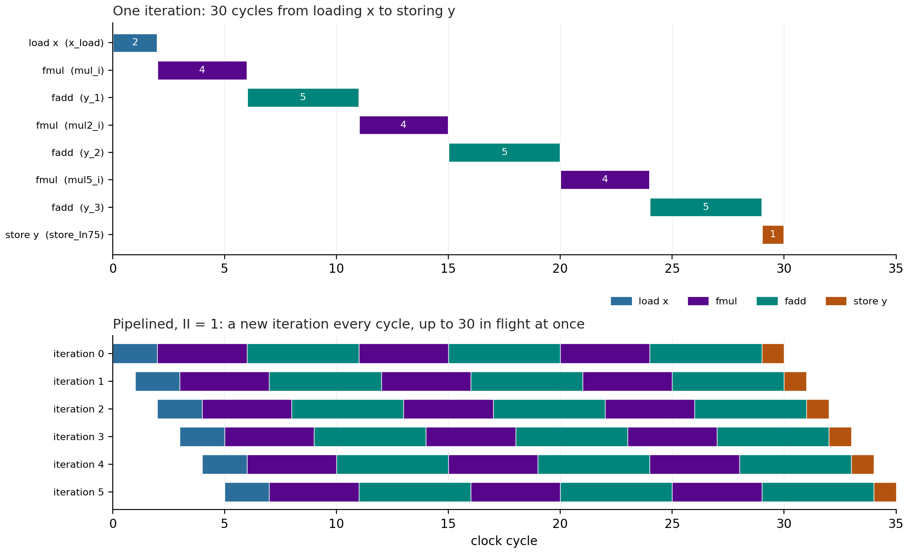

# The Pipeline Schedule

[Pipelining the loop](pipeline.md) found that the pipelined loop has an
iteration latency of 30 cycles and an II of 1. This page looks at the
schedule behind those two numbers: what happens in each of the 30 cycles
of one iteration, and how 30 iterations share the hardware at once.

The `schedule_pipe` step draws it. To run it on its own:

```bash
(env) python poly_build.py --through schedule_pipe
```

## Where the schedule report is

The [timing demo](../timing/synth_sched.md) introduced the schedule
report for a function. A pipelined loop gets one of its own, because
Vitis synthesizes it as a separate module, `poly_Pipeline_sample_loop`,
which the top function `poly` starts and waits for:

```
hwdesign/demos/pipeline/poly/proj_pipe/sol/.autopilot/db/poly_Pipeline_sample_loop.verbose.sched.rpt
```

The same cautions apply as before: `.autopilot` is hidden from most file
browsers, the file exists only after synthesis, and it is an internal
Vitis file whose format can change between versions. These excerpts are
from Vitis 2025.1.

The report opens with the pipeline:

```text
* Number of FSM states : 30
* Pipeline : 1
  Pipeline-0 : II = 1, D = 30, States = { 1 2 3 4 5 6 7 8 9 10 11 12 13 14 15 16 17 18 19 20 21 22 23 24 25 26 27 28 29 30 }
```

`D = 30` is the **depth**: one iteration passes through 30 states, one
per clock cycle. That is the iteration latency in the synthesis report.
`II = 1` is the initiation interval.

## One iteration, state by state

Trimmed to the operations that do the work, the states read:

```text
ST_1 : Operation 52 [2/2] (3.25ns)   --->   "%x_load = load i10 %x_addr" [poly.cpp:75]   <CoreInst = "RAM_1P">
ST_2 : Operation 54 [1/2] ( I:3.25ns O:3.25ns )   --->   "%x_load = load i10 %x_addr" [poly.cpp:75]
ST_3 : Operation 56 [4/4] (5.70ns)   --->   "%mul_i = fmul i32 %p_reload9_read, i32 %bitcast_ln75_1" [poly.cpp:32->poly.cpp:75]   <CoreInst = "FMul_maxdsp">
ST_4 : Operation 57 [3/4] (5.70ns)   --->   "%mul_i = fmul i32 ..." [poly.cpp:32->poly.cpp:75]
ST_5 : Operation 58 [2/4] (5.70ns)   --->   "%mul_i = fmul i32 ..." [poly.cpp:32->poly.cpp:75]
ST_6 : Operation 59 [1/4] (5.70ns)   --->   "%mul_i = fmul i32 ..." [poly.cpp:32->poly.cpp:75]
ST_7 : Operation 60 [5/5] (7.25ns)   --->   "%y_1 = fadd i32 %mul_i, i32 %p_reload8_read" [poly.cpp:32->poly.cpp:75]   <CoreInst = "FAddSub_fulldsp">
...
ST_29 : Operation 82 [1/5] (7.25ns)   --->   "%y_3 = fadd i32 %mul5_i, i32 %p_reload_read" [poly.cpp:34->poly.cpp:75]
ST_30 : Operation 88 [1/1] ( I:3.25ns O:3.25ns )   --->   "%store_ln75 = store i32 %bitcast_ln75, i10 %y_addr" [poly.cpp:75]   <CoreInst = "RAM_1P">
```

New here, compared with the timing demo, is the `[k/n]` count: an
operation that takes `n` states appears in each of them, counting down
from `[n/n]` to `[1/n]`. `poly_analysis.py` collects them into one row per
operation, in `results/schedule_pipe.md`:

| Operation | Kind | States | Cycles | Source |
|---|---|---|---|---|
| `x_load` | load | 1–2 | 2 | `y[i] = horner(c, x[i])`, line 75 |
| `mul_i` | fmul | 3–6 | 4 | `y = y * x + c[2]`, line 32 |
| `y_1` | fadd | 7–11 | 5 | line 32 |
| `mul2_i` | fmul | 12–15 | 4 | `y = y * x + c[1]`, line 33 |
| `y_2` | fadd | 16–20 | 5 | line 33 |
| `mul5_i` | fmul | 21–24 | 4 | `y = y * x + c[0]`, line 34 |
| `y_3` | fadd | 25–29 | 5 | line 34 |
| `store_ln75` | store | 30 | 1 | line 75 |

`poly.cpp:32->poly.cpp:75` means line 32, inside `horner()`, inlined into
the loop at line 75.

Reading it:

- **The load takes 2 states.** The address goes out to the RAM in state
  1, and the word comes back in state 2: a block RAM has one cycle of read
  latency.
- **A multiply takes 4 states and an add 5.** These are AMD's
  floating-point cores, `fmul_32ns_32ns_32_4_max_dsp` and
  `fadd_32ns_32ns_32_5_full_dsp` in the synthesis report. Each is
  internally pipelined; Vitis picked the versions with enough stages for
  each stage to fit the clock.
- **Everything is in series.** Horner's method is a chain: each step needs
  the one before. 2 + 3 × (4 + 5) + 1 = 30.

Drawn as a chart, the top half of `results/schedule_pipe.png`:



## Many iterations at once

The bottom half draws the first six iterations, each starting one cycle
(II = 1) after the one before. Read it down a column, at one clock cycle:
every iteration is at a different step. At cycle 5, iterations 4 and 5
are loading their `x`, and iterations 0 to 3 are all in the first
multiply, each at a different one of its 4 stages: the multiplier is
itself a pipeline, holding four samples at once. Once 30 iterations have
started, every one of the 30 stages is busy, each with a different sample.

That is why the pipelined loop needs **three multipliers and three
adders**. In any one cycle, the first, second and third multiplies are
all running, for different samples, so each needs its own hardware.
The unpipelined loop runs one operation at a time, so one multiplier and
one adder serve all six, which is the resource saving
[the report showed](pipeline.md#reading-the-report).

## Why II = 1 is possible here

A new iteration can start every cycle because **no iteration needs a
result from the one before**: `y[i]` depends only on `x[i]` and the
coefficients. Sample `i+1` can start before sample `i` is done.

Change that, and the II goes up. The lecture's example of a
**loop-carried dependency** is an accumulation,

```cpp
acc += horner(c, x[i]);
```

where every iteration's add needs the last iteration's sum. The next add
cannot start until the last one is finished, so iterations start no
faster than one adder latency apart, whatever the pragma asks for. Vitis
reports the II it *achieved*, beside the one it was asked for, and warns
when they differ.

Two more things limit II, and part 2 runs into the first:

- **Memory ports.** Each iteration loads one `x` and stores one `y`, and
  each memory has one port. At II = 1 that is exactly enough.
  [Unrolling](unroll.md) asks for more.
- **Timing.** The `Timing violations` section of the report gives each
  state's delay. The slowest are the `fadd` states, 7.256 ns of the 7.3 ns
  budget (10 ns, less 2.7 ns of uncertainty): the synthesis report's slack
  of 0.04 ns. Neither is a problem here, but it says how full each stage is.

Next: [unrolling the loop](unroll.md).
