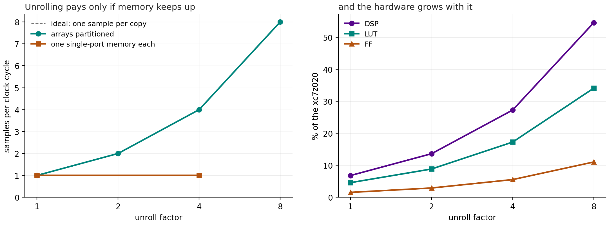
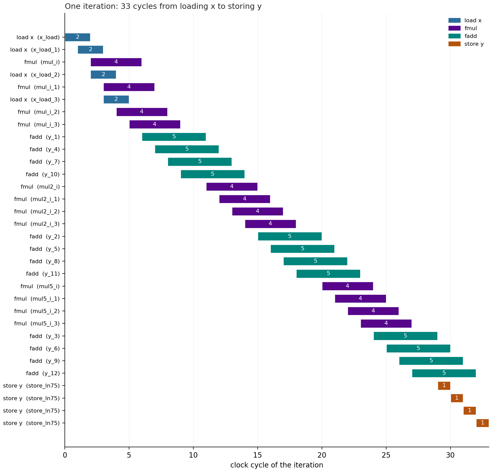
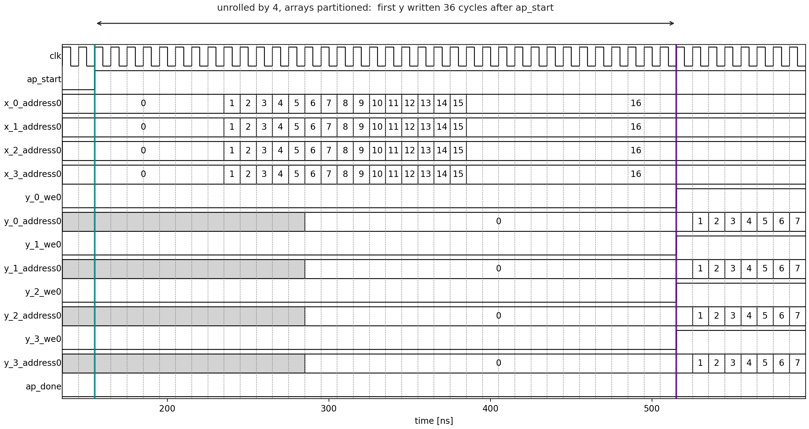

# Unrolling the Loop

Pipelining got the loop to one sample per clock cycle. To go faster at
the same clock, the hardware has to start **more than one sample per
cycle**. That is what unrolling does, and this page measures what it
costs, and the one thing that can stop it working: memory.

## Unrolling

```cpp
    sample_loop: for (int i = 0; i < nsamp; i++) {
        #pragma HLS PIPELINE II=1
        #pragma HLS UNROLL factor=4
        y[i] = horner(c, x[i]);
    }
```

`UNROLL factor=4` makes four copies of the loop body. Vitis rewrites the
loop as if it were

```cpp
    for (int i = 0; i < nsamp; i += 4) {
        y[i]   = horner(c, x[i]);
        y[i+1] = horner(c, x[i+1]);
        y[i+2] = horner(c, x[i+2]);
        y[i+3] = horner(c, x[i+3]);
    }
```

(with checks for an `nsamp` that is not a multiple of 4), and pipelines
that. A quarter of the iterations, each handling four samples: if each
still starts one cycle after the last, that is **four samples per cycle**,
and four times the arithmetic to do it.

## The memory bottleneck

Each of those iterations reads four words of `x` and writes four of `y`.
But each array is in a single-port RAM (`storage_type=ram_1p`): **one**
read or write per cycle. Four reads take four cycles, whatever the
pragma asks for.

The fix, from the lecture, is to **partition** the array: split it over
several memories, so each has a port of its own.

```cpp
    #pragma HLS ARRAY_PARTITION variable=x type=cyclic factor=4
    #pragma HLS ARRAY_PARTITION variable=y type=cyclic factor=4
```

`cyclic` deals the elements out like cards: `x[0]` to memory 0, `x[1]` to
memory 1, `x[2]` to 2, `x[3]` to 3, `x[4]` back to memory 0, and so on.
The four samples one unrolled iteration needs, `x[i]` to `x[i+3]`, are
then in four different memories, and can all be read in the same cycle.
(`block` would put the first quarter of the array in memory 0, the next
in memory 1, ..., which suits a loop that walks four separate stretches
of the array instead.)

`x` and `y` are arguments of the top function, so partitioning them
changes the **interface**: the IP gets four memory ports for each, and
whatever is connected to it has to supply four RAMs. From
`proj_u4/sol/syn/report/csynth.rpt`:

```text
* AP_MEMORY
| x_0_address0    | out       | 8        |
| x_0_q0          | in        | 32       |
| x_1_address0    | out       | 8        |
| x_1_q0          | in        | 32       |
...
```

Each address is now 8 bits: each memory holds 256 of the 1024 samples.

## Running part 2

```bash
(env) python poly_build.py
```

runs everything part 1 did not, about ten minutes:

```
verify_csim -> synth_unroll -> unroll_report ------------------------------------------> unroll
                            -> schedule_nopart
                            -> cosim_unroll -> verify_cosim_unroll -> vcd_unroll -> timing_unroll
```

`synth_unroll` builds four variants:

- `u2`, `u4`, `u8`: pipelined, unrolled by 2, 4 and 8, with `x` and `y`
  partitioned to match
- `u4_nopart`: unrolled by 4, **without** partitioning, to see the
  bottleneck

To sweep other factors, or simulate another one:

```bash
(env) python poly_build.py --unroll 2 4 8 16 --force-step synth_unroll
(env) python poly_build.py --sim-unroll 8 --force-step cosim_unroll
```

## The results

`results/unroll.md`, with the pipelined loop from part 1 as unroll factor
1:

| Unroll | Partitioned | II | Trip count | Samples / cycle | Cycles, 1024 samples | DSP | FF | LUT |
|---|---|---|---|---|---|---|---|---|
| 1 | - | 1 | 1024 | 1 | 1063 | 15 (7%) | 1651 | 2444 (5%) |
| 2 | yes | 1 | 512 | 2 | 552 | 30 (14%) | 3112 | 4714 (9%) |
| 4 | yes | 1 | 256 | 4 | 296 | 60 (27%) | 5905 | 9186 (17%) |
| 8 | yes | 1 | 128 | 8 | 168 | 120 (55%) | 11752 | 18138 (34%) |
| 4 | no | 4 | 256 | 1 | 1066 | 15 (7%) | 2909 | 3190 (6%) |

and `results/unroll.png`:



### With partitioning: throughput and hardware grow together

Each doubling of the unroll factor halves the trip count, keeps II at 1,
and so doubles the samples per cycle. The cycles for 1024 samples fall
from 1063 to 168: 128 iterations, plus the same 30-cycle pipeline depth
and the same few cycles for the coefficients and the handshake. Those do
not shrink, so the speed-up falls a little short of 8 times.

The hardware doubles too: each copy of the body has its own three
multipliers and three adders, 15 DSPs per copy. At factor 8 that is 120
of the chip's 220 DSPs. Factor 16 would need 240, more than the chip
has. Throughput is bought with area, at a nearly fixed price per sample.

### Without partitioning: no faster at all

`u4_nopart` has the hardware for four samples per cycle and runs at
**one**, like the plain pipelined loop. Its row in
`proj_u4_nopart/sol/syn/report/csynth.rpt` is flagged:

```text
| o sample_loop               |    II|  7.30|     1055|  1.055e+04|        33|        4|   256|       yes|
```

The `II` in the Issue Type column means Vitis could not reach the II it
was asked for. The synthesis log, `proj_u4_nopart/sol/sol.log`, says why:

```text
WARNING: [HLS 200-885] The II Violation in module 'poly_Pipeline_sample_loop' (loop 'sample_loop'):
Unable to schedule 'load' operation 32 bit ('x_load_1', poly.cpp:75) on array 'x' due to limited
memory ports (II = 2). Please consider using a memory core with more ports or partitioning the array 'x'.
```

It tried II = 1, 2 and 3 and settled on 4. The schedule shows the
conflict, `results/schedule_nopart.png`:



The four loads of `x` start one cycle apart, cycles 0 to 3, because they
share one port, and the four stores at the end are in four different
cycles for the same reason. With the port busy in every one of 4 cycles,
the next iteration cannot start for 4 cycles.

Notice the DSP count: 15, not 60. With an iteration only every 4 cycles,
the four copies of each multiply come one cycle apart and can take turns
on one multiplier, so Vitis **shares** them, as it did for the
[unpipelined loop](pipeline.md#reading-the-report). It still pays in
flip-flops and LUTs for the bookkeeping. Unrolling without the memory
bandwidth to feed it buys nothing.

## The timing diagram

`timing_unroll` draws the co-simulation of `u4`, `results/timing_unroll.png`:



- The four `x` ports, `x_0` to `x_3`, step through their addresses
  **together**, one per cycle: four samples read every cycle. The 64
  samples are 16 per memory, so the addresses stop at 15.
- The first `y` is still written 36 cycles after `ap_start`: unrolling,
  like pipelining, does nothing for the latency of one sample.
- From there the four `y` write enables are high together: four results
  per cycle.

Co-simulation measured **52 cycles** for the 64 samples, against 99
pipelined and 1927 not pipelined, and checked every one bit for bit.
`results/summary.json` collects the numbers from both parts.

## What to take away

| | Cycles, 64 samples (simulated) | DSP |
|---|---|---|
| not pipelined | 1927 | 5 |
| pipelined, II = 1 | 99 | 15 |
| unrolled by 4, partitioned | 52 | 60 |
| unrolled by 4, not partitioned | about 99 (II = 4, from the report) | 15 |

- **Pipelining** keeps every unit busy, so it usually costs little and
  gains a lot. It does not change the latency of one sample.
- **Unrolling** buys throughput with area, at a nearly fixed price per
  sample per cycle, until the chip runs out.
- Either one is limited by whatever runs out first: a loop-carried
  dependency, the clock, or, most often, **memory ports**.
