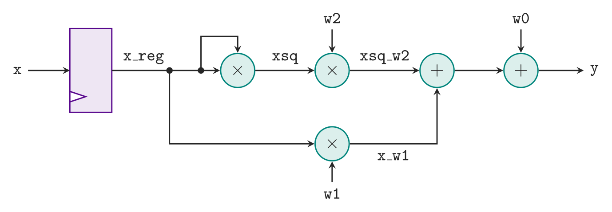

# The Kernel

The demo synthesizes one function, the quadratic from the unit 6 lecture:

```
y = w2*x^2 + w1*x + w0
```

## The circuit

This is the block diagram from the lecture's quadratic example:



Three multiplications and two additions. The longest path runs through
two multipliers in series, `x*x` and then `w2*xsq`, and then the adders.
The `w1*x` multiply is in parallel with the first two, so it is not on
the critical path.

The lecture's version registers x first, into `x_reg`. The kernel here
leaves that out: x comes straight off its input wire, and Vitis decides
where the registers go.

## The code

`demos/timing/quad/quad.h`:

```cpp
#include <ap_int.h>

typedef ap_int<8> in_t;
typedef ap_int<26> out_t;

out_t quad(in_t x, in_t w2, in_t w1, in_t w0);
```

`demos/timing/quad/quad.cpp`:

```cpp
out_t quad(in_t x, in_t w2, in_t w1, in_t w0) {

    #pragma HLS INTERFACE mode=ap_none    port=x
    #pragma HLS INTERFACE mode=ap_none    port=w2
    #pragma HLS INTERFACE mode=ap_none    port=w1
    #pragma HLS INTERFACE mode=ap_none    port=w0
    #pragma HLS INTERFACE mode=ap_ctrl_hs port=return

    ap_int<16> xsq = x * x;
    ap_int<24> xsq_w2 = w2 * xsq;
    ap_int<16> x_w1 = w1 * x;
    return xsq_w2 + x_w1 + w0;
}
```

There is no loop, and no clock in sight. The C++ says only *what* is
computed; how many clock cycles it takes is up to Vitis, and depends on
the clock it is asked to meet.

### The widths

The inputs are 8-bit signed integers, `ap_int<8>`, from -128 to 127.
Each intermediate is declared just wide enough to hold any value it can
take, so nothing is truncated:

| Signal | Computed as | Bits |
|---|---|---|
| `xsq` | 8-bit × 8-bit | 16 |
| `xsq_w2` | 8-bit × 16-bit | 24 |
| `x_w1` | 8-bit × 8-bit | 16 |
| `y` | 24 + 16 + 8 bits, summed | 26 |

The width matters for timing too. An 8-bit by 16-bit multiply fits in one
DSP block, the FPGA's hardware multiplier. A 32-bit `int` multiply needs
several DSP blocks chained together, which makes the timing much harder
to read; [the sweep page](sweep.md#why-the-script-sets-the-multipliers-implementation)
says more.

## No AXI

The interface is the simplest one Vitis HLS has. `run.tcl` builds the
kernel for the **Vivado IP flow**:

```tcl
open_solution -reset -flow_target vivado p10
```

In that flow, with the pragmas above:

- each scalar argument is a plain input wire, `ap_none`: whatever is on
  the wire is the value
- the return value comes out on a wire called `ap_return`
- the only control is the **`ap_ctrl_hs`** handshake: the caller raises
  `ap_start`, and the IP raises `ap_done` when `ap_return` holds the
  answer

So the synthesized IP's ports are just:

| Port | Direction | Width | What it is |
|---|---|---|---|
| `ap_clk`, `ap_rst` | in | 1 | clock and reset |
| `ap_start` | in | 1 | start a call |
| `ap_done` | out | 1 | the answer is on `ap_return` |
| `ap_idle`, `ap_ready` | out | 1 | idle; ready for the next call |
| `x`, `w2`, `w1`, `w0` | in | 8 | the inputs |
| `ap_return` | out | 26 | y |

The cycles from `ap_start` to `ap_done` are the **latency**, which is
what the rest of this demo measures.

In the Vitis *kernel* flow (`-flow_target vitis`), every scalar argument
would instead become a register on an AXI4-Lite bus, as in the
[scalar function demo](../procif/). That is what a processor needs to
reach the IP, but here it would only add bus cycles between the inputs
and the arithmetic.

## The testbench and the model

`tb_quad.cpp` calls `quad()` on five test cases and writes the
results to `results.json`. The same testbench runs twice: against the C++
function in C simulation, and against the synthesized RTL in
co-simulation, where each call becomes one `ap_start` / `ap_done`
handshake on the wires.

`golden.py` is an independent Python model, and the single source of the
test vector. The first three cases are the lecture's example:

| x | w2 | w1 | w0 | y |
|---|---|---|---|---|
| 10 | 5 | -7 | 4 | 434 |
| -4 | 5 | -7 | 4 | 112 |
| 8 | 5 | -7 | 4 | 268 |

Next: [synthesizing it at one clock](synth.md).
