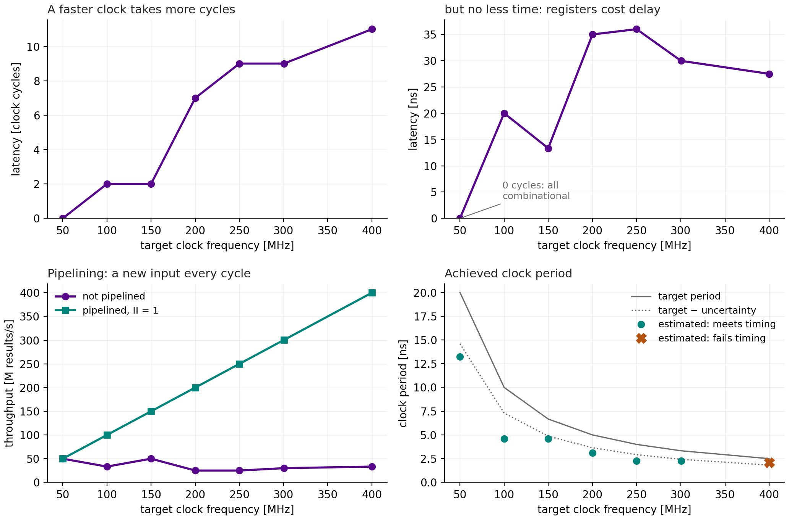
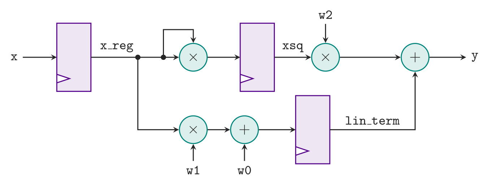
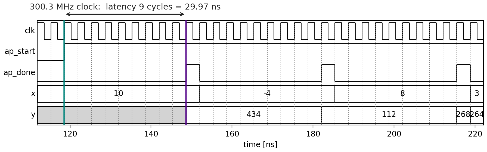
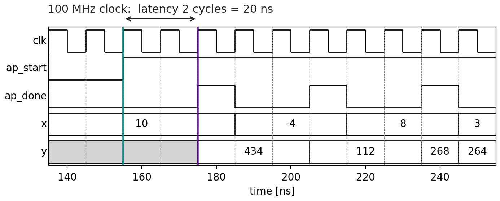

# Sweeping the Clock

The [previous page](synth.md) synthesized the kernel for one clock,
100 MHz, and found a latency of 2 cycles. This page asks the same question
at seven clocks, from 50 to 400 MHz, and compares the answers.

## Running the sweep

From `hwdesign/demos/timing/quad`:

```bash
(env) python quad_build.py --force-step sweep
```

That synthesizes all seven clock periods, the default, and then runs
everything after: about eight minutes, most of it the two co-simulations.
To sweep other periods, list them in ns:

```bash
(env) python quad_build.py --periods 10 5 2.5 --fast-ns 2.5 --force-step sweep
```

`--slow-ns` and `--fast-ns` (10 and 3.33 by default) pick the two
solutions that are simulated, and must be among the swept periods.

## How the sweep is built

### In Vitis: one solution per clock

A Vitis HLS project can hold several **solutions**: the same source, built
with different settings. The sweep stage of `run.tcl` makes one per clock
period, all in one Vitis session:

```tcl
foreach pipelined {0 1} {
    foreach period $periods {
        set name [solution_name $period $pipelined]     ;# p10, p3_33, pipe_p10, ...
        open_solution -reset -flow_target vivado $name
        set_part $part
        create_clock -period $period
        config_op mul -impl dsp -latency -1
        config_op add -impl fabric
        if {$pipelined} {
            set_directive_pipeline -II 1 quad
        }
        csynth_design
        close_solution
    }
}
```

Each solution gets its own report, so they can all be read afterwards.
Two settings here need explaining: `config_op` [below](#why-the-script-sets-the-multipliers-implementation),
and the pipeline directive [under pipelining](#pipelining).

### In Python: running the stage, and reading the results

The `sweep` step in `quad_build.py` runs that stage, passing the periods
through an environment variable:

```python
def run(self, config: BuildConfig, periods, live_output, **_) -> dict:
    out_dir = config.root_dir / "results" / "sweep"
    _run_stage(config, "sweep", out_dir, live_output=live_output,
               QUAD_PERIODS=" ".join(f"{p:g}" for p in periods))
    marker = out_dir / "periods.txt"
    marker.write_text(" ".join(f"{p:g}" for p in periods) + "\n", encoding="utf-8")
    return {"sweep_done": marker}
```

`sweep_report` then reads every solution's report, with the same
`read_solution` function the [previous page](synth.md#reading-the-report-from-python)
used for one, and writes a table and a plot:

```python
def read_sweep(root: Path, periods: list[float]) -> list[dict]:
    """One row per (variant, period), slowest clock first."""
    return [read_solution(root, p, pipe) for pipe in (False, True)
            for p in sorted(periods, reverse=True)]
```

```python
rows = quad_timing.read_sweep(config.root_dir, swept_periods(sweep_done))
quad_timing.write_sweep_table(rows, results / "sweep.md")
quad_timing.write_sweep_plot(rows, results / "sweep.png")
```

## The results

`results/sweep.md`, for the function as written:

| Clock | Target period | Estimated period | Latency | Latency | Interval |
|---|---|---|---|---|---|
| 50 MHz | 20 ns | 13.23 ns | 0 cycles | same cycle | 1 |
| 100 MHz | 10 ns | 4.59 ns | 2 cycles | 20 ns | 3 |
| 150 MHz | 6.67 ns | 4.59 ns | 2 cycles | 13.3 ns | 3 |
| 200 MHz | 5 ns | 3.10 ns | 7 cycles | 35 ns | 8 |
| 250 MHz | 4 ns | 2.29 ns | 9 cycles | 36 ns | 10 |
| 300 MHz | 3.33 ns | 2.29 ns | 9 cycles | 30 ns | 10 |
| 400 MHz | 2.5 ns | 2.12 ns, fails | 11 cycles | 27.5 ns | 12 |

and `results/sweep.png`:



### A faster clock takes more cycles

The top left panel. Each operation takes about 4.5 ns, as the
[schedule at 100 MHz](synth.md#the-schedule-what-happens-in-each-cycle)
showed, so how many fit in a cycle depends on the cycle:

- **At 50 MHz** the budget is 20 − 5.4 = 14.6 ns, and the whole chain,
  two multiplies and the adder, takes 13.2 ns. It fits in one clock
  period: the latency is **0 cycles**, and `ap_done` rises in the same
  cycle as `ap_start`. The circuit is purely combinational.
- **At 100 and 150 MHz** only one operation fits per cycle, so the chain
  takes three states: **2 cycles**.
- **At 200 MHz and above** even one multiply does not fit. Vitis turns on
  the registers inside each DSP block, so a multiply itself spans several
  cycles, and the three-input adder is split into its two additions, a
  cycle each. Counting the states in each solution's schedule
  (`quad.verbose.sched.rpt`, as on the [previous page](synth.md#the-schedule-what-happens-in-each-cycle)):

  | Clock | `x*x` | `w2*xsq` | additions | states | latency |
  |---|---|---|---|---|---|
  | 200 MHz | 3 | 3 | 1 + 1 | 8 | 7 cycles |
  | 300 MHz | 4 | 4 | 1 + 1 | 10 | 9 cycles |
  | 400 MHz | 4 | 4 | 2 + 2 | 12 | 11 cycles |

  The latency is the number of states less one: the first state is the
  cycle `ap_start` arrives in.

This is the lecture's two-cycle design, done by the tool:



In the lecture, registers were put in by hand to split the critical path.
Here Vitis puts them in, as many as the clock needs.

### But not less time

The top right panel. The latency in ns does **not** fall as the clock
speeds up. At 100 MHz the answer takes 20 ns, and at 300 MHz 30 ns.
Every register costs time of its own, its clock-to-Q and setup, and the
pieces between registers are never exactly balanced, so part of each
period goes unused. A faster clock does not give the answer sooner. What
it can give is **throughput**, if the hardware starts a new call before
the last one finishes: that is pipelining, below.

### Meeting timing

The bottom right panel. Up to 300 MHz, the estimated period fits inside
the budget, the target less the uncertainty. At **400 MHz** it does not:
2.12 ns against a budget of 2.5 − 0.68 = 1.82 ns. The estimate has
stopped falling, because the slowest operation left is one Vitis cannot
split any further. So this design **fails timing** at 400 MHz, and
300 MHz is the fastest clock in the sweep that it meets.

These are **estimates** from C synthesis. The real timing comes from
Vivado's place and route, which can be better or worse.

### The timing diagram at 300 MHz

`timing_fast` draws the co-simulation of the 300 MHz solution, beside the
100 MHz one from the previous page:





The same call, x = 10 giving y = 434: **9 cycles at 300 MHz** against
2 at 100 MHz. In time, 30 ns against 20. `results/summary.json` records
the cycles both co-simulations measured, which are the report's.

## Pipelining

Without pipelining, a new call can start only after the previous one has
finished: the **interval** is the latency plus one. At 300 MHz that is one
result every 10 cycles, 30 M results/s.

The `pipe_` solutions are the same function with the directive

```tcl
set_directive_pipeline -II 1 quad
```

which is the same as writing

```cpp
#pragma HLS PIPELINE II=1
```

at the top of `quad()`. `II` is the **initiation interval**: a new call
every cycle. The registers Vitis already placed now hold several calls at
once, one per stage, like the pipelined design in the lecture.

`results/sweep.md`, pipelined:

| Clock | Latency | Interval | Throughput | FF |
|---|---|---|---|---|
| 100 MHz | 2 cycles | 1 | 100 M results/s | 97 |
| 300 MHz | 9 cycles | 1 | 300 M results/s | 295 |

against 33 and 30 M results/s, and 73 and 103 flip-flops, without it.
The latency does not change. The throughput equals the clock rate: the
bottom left panel. The cost is the extra registers that keep one call's
values while the next call's are computed.

## Why the script sets the multipliers' implementation

Left to itself, Vitis fuses each multiply and the addition after it into
a single DSP "multiply-add", `mac_muladd`, with a fixed number of
pipeline stages, whatever the clock. That hides the scheduling this demo
is about: the latency is then 3 cycles even at 50 MHz. So `run.tcl` keeps
the additions out of the DSP blocks, and lets the scheduler choose how
many of each DSP's internal registers to use:

```tcl
config_op mul -impl dsp -latency -1
config_op add -impl fabric
```

`-latency -1` means "you choose". The reports show the choice in the
multipliers' names. At 300 MHz, `quad_proj/p3_33/syn/report/quad_csynth.rpt`
lists `mul_8s_8s_16_4_1`: an 8-bit by 8-bit multiply with a 16-bit result,
spread over **4** clock cycles. At 100 MHz the same multiply is
`mul_8s_8s_16_1_1`, done within one cycle with none of its internal
registers in use.

With 32-bit `int` arguments the picture is noisier again: each multiply
then needs several DSP blocks chained together, and Vitis pipelines the
chain more deeply. That is why the kernel uses 8-bit inputs.
