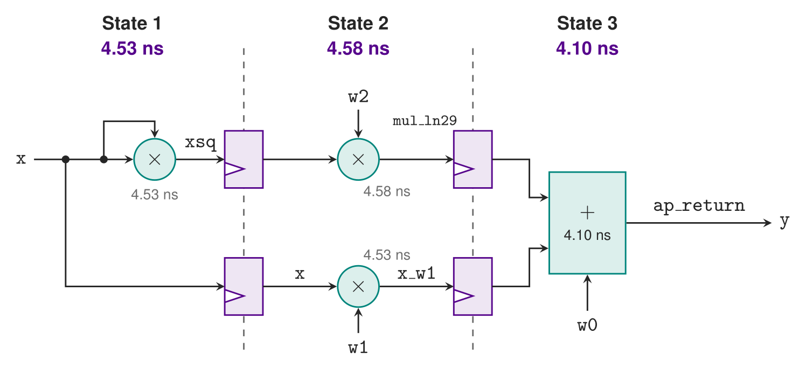

# Analyzing the Schedule

The [synthesis report](synth.md#reading-the-synthesis-report) said the
kernel takes 2 cycles at 100 MHz. This page looks at *how* Vitis got
there: which operation it put in which clock cycle, how long each cycle's
logic takes, and how much of the clock period is left over.

## What is a schedule?

C++ says only *what* is computed. Before Vitis can write any RTL, it has
to decide **when** each operation happens: in which clock cycle. That
decision is the **schedule**.

Each clock cycle of the schedule is called a **state**, because the RTL
runs through them with a small state machine (the `ap_CS_fsm` register in
the synthesis report). Vitis builds the schedule under two rules:

- an operation can start only once its inputs are ready, and
- the logic in one state, everything that runs between two clock edges,
  must fit in the clock period, less the clock uncertainty.

At 10 ns with 2.7 ns of uncertainty, that leaves **7.3 ns per state**. Two
operations in series go in the same state only if their delays add up to
7.3 ns or less. Otherwise Vitis puts a register between them, and the
second one goes in the next state.

This is the critical-path reasoning from the lecture, done by the tool.

## Where the schedule report is

Vitis writes the schedule into the solution's working directory, for each
solution it synthesizes:

```
hwdesign/demos/timing/quad/quad_proj/p10/.autopilot/db/quad.verbose.sched.rpt
```

- `.autopilot` starts with a dot, so file browsers and `ls` hide it unless
  you ask for hidden files. VS Code's Explorer shows it.
- It exists only after a build has synthesized that solution.
  `quad_proj/` is a build output, not in git.
- This is an internal file of Vitis, not one of its documented reports.
  Its location, its name and its format may change between Vitis versions.
  These excerpts are from Vitis 2025.1. If it has moved, search the
  solution directory for `*.sched.rpt`.

Every solution has its own: `quad_proj/p3_33/.autopilot/db/...` is the
schedule at 300 MHz, and `quad_proj/pipe_p10/...` the pipelined one at
100 MHz.

The report starts with the same summary as `quad_csynth.rpt`, then gives
the schedule in three sections.

### The number of states

```text
============================================================
+ Verbose Summary: Schedule
============================================================
* Number of FSM states : 3
```

Three states. The latency counts the clock edges from the first state to
the last, so 3 states is a latency of 2 cycles.

### What happens in each state

Next, every operation, state by state. Most lines are bookkeeping: port
reads, sign extensions (`sext`) and interface declarations, all of them
0 ns. The lines that take time, trimmed to the parts that matter, are:

```text
State 1 <SV = 0> <Delay = 4.53>
ST_1 : Operation 6  [1/1] (4.53ns)   ---> "%xsq = mul i16 %sext_ln26, i16 %sext_ln26" [quad.cpp:26]   <CoreInst = "Mul_DSP">

State 2 <SV = 1> <Delay = 4.58>
ST_2 : Operation 11 [1/1] (4.58ns)   ---> "%mul_ln29 = mul i22 %sext_ln29_1, i22 %sext_ln29" [quad.cpp:29]   <CoreInst = "Mul_DSP">
ST_2 : Operation 13 [1/1] (4.53ns)   ---> "%x_w1 = mul i16 %sext_ln28, i16 %sext_ln26" [quad.cpp:28]   <CoreInst = "Mul_DSP">

State 3
ST_3 : Operation 28 [1/1] (0.00ns) (grouped into TernaryAdder)   ---> "%add_ln29 = add i23 %sext_ln29_2, i23 %sext_ln29_3" [quad.cpp:29]
ST_3 : Operation 30 [1/1] (4.10ns) (root node of TernaryAdder)   ---> "%add_ln29_1 = add i23 %add_ln29, i23 %sext_ln29_4" [quad.cpp:29]
ST_3 : Operation 32 [1/1] (0.00ns)   ---> "%ret_ln30 = ret i26 %sext_ln30" [quad.cpp:30]
```

How to read a line:

- `ST_2` is the state, and `(4.58ns)` the operation's delay.
- `%mul_ln29 = mul i22 ...` is the operation: a 22-bit multiply whose
  result Vitis calls `mul_ln29`, because it is on line 29 of `quad.cpp`,
  `w2 * xsq`. `xsq` and `x_w1` keep the names from the source.
- `[quad.cpp:29]` is the source line.
- `<CoreInst = "Mul_DSP">` is the hardware: a DSP block.
- `[1/1]` means the operation is done within this one state. A multiply
  spread over several states, as at 300 MHz, shows `[4/4]`, `[3/4]`, ...
  in each one.
- In state 3, the two additions are fused into one three-input adder,
  `TernaryAdder`, which takes 4.10 ns in all.

The same information in compact form is in `quad.verbose.rpt`, beside it,
under `FSMD analyzer results`:

```text
  - Chain level:
	State 1
		xsq : 1
	State 2
		mul_ln29 : 1
		x_w1 : 1
	State 3
		add_ln29 : 1
		add_ln29_1 : 2
		sext_ln30 : 3
		ret_ln30 : 4
```

The number after each operation is its position in the chain of logic
within that state: in state 2, both multiplies are at level 1, running in
parallel; in state 3, `add_ln29` feeds `add_ln29_1`.

That section also says **when each input is read**:

```text
 - Input state :
	Port: quad : x | {1 }
	Port: quad : w2 | {2 }
	Port: quad : w1 | {2 }
	Port: quad : w0 | {3 }
```

Vitis reads each input wire only in the state that needs it: `w0` not
until state 3. With plain `ap_none` wires, the caller must hold every
input steady from `ap_start` to `ap_done`.

## The schedule as a block diagram

Putting the operations in their states, with the registers Vitis places
between them:



The registers are the ones the synthesis report's register section listed:
`xsq_reg`, `mul_ln29_reg` and `x_w1_reg`, and `sext_ln26_reg`, which is
**x itself**, held over to state 2 for the `w1*x` multiply. Every value
that crosses a state boundary needs a register, inputs included.

Why this schedule:

- `x*x` and then `w2*xsq` are in series. Together they take
  4.53 + 4.58 = 9.1 ns, more than 7.3, so they cannot share a state.
- `w1*x` depends only on `x`, so it could have gone in state 1 or state 2.
  Vitis put it in state 2, beside `w2*xsq`.
- The adder needs `mul_ln29`, which is ready only at the end of state 2.
  `mul_ln29` plus the adder is 4.58 + 4.10 = 8.7 ns, again more than 7.3,
  so the adder gets a state of its own.

## Where the report shows the timing slack

**Slack** is how much of the clock period is left over: the budget, less
what the logic actually takes. Positive slack meets timing; negative slack
fails it.

### For the whole design

The summary report, `quad_proj/p10/syn/report/csynth.rpt`, has a `Slack`
column in its table of modules:

```text
+--------+------+------+---------+--------+----------+---------+------+----------+------+--------+----------+----------+-----+
| Modules| Issue|      |      Latency     | Iteration|         | Trip |          |      |        |          |          |     |
| & Loops| Type | Slack| (cycles)|  (ns)  |  Latency | Interval| Count| Pipelined| BRAM |   DSP  |    FF    |    LUT   | URAM|
+--------+------+------+---------+--------+----------+---------+------+----------+------+--------+----------+----------+-----+
|+ quad  |     -|  2.71|        2|  20.000|         -|        3|     -|        no|     -|  3 (1%)|  73 (~0%)|  66 (~0%)|    -|
+--------+------+------+---------+--------+----------+---------+------+----------+------+--------+----------+----------+-----+
```

2.71 ns is the budget, 7.3 ns, less the slowest state, 4.586 ns: the
design's worst case. A design that fails timing shows a negative number
here, and a timing issue in the `Issue Type` column.

### For each state

The schedule report gives each state's delay and the path that sets it, in
a section called `Timing violations`. Vitis prints it whether or not
anything is violated:

```text
============================================================
+ Verbose Summary: Timing violations
============================================================
Target clock period: 10.000ns, clock uncertainty: 2.700ns.

 <State 1>: 4.537ns
The critical path consists of the following:
	wire read operation ('x_read', quad.cpp:17) on port 'x' (quad.cpp:17) [19]  (0.000 ns)
	'mul' operation 16 bit ('xsq', quad.cpp:26) [21]  (4.537 ns)

 <State 2>: 4.586ns
The critical path consists of the following:
	wire read operation ('w2_read', quad.cpp:17) on port 'w2' (quad.cpp:17) [18]  (0.000 ns)
	'mul' operation 22 bit ('mul_ln29', quad.cpp:29) [24]  (4.586 ns)

 <State 3>: 4.108ns
The critical path consists of the following:
	wire read operation ('w0_read', quad.cpp:17) on port 'w0' (quad.cpp:17) [16]  (0.000 ns)
	'add' operation 23 bit ('add_ln29_1', quad.cpp:29) [31]  (4.108 ns)
```

Each state's slack is the 7.3 ns budget less its delay:

| State | Delay | Slack |
|---|---|---|
| 1 | 4.54 ns | 2.76 ns |
| 2 | 4.59 ns | **2.71 ns**, the smallest: the number in `csynth.rpt` |
| 3 | 4.11 ns | 3.19 ns |

Every state has more than 2.7 ns to spare: over a third of each clock
period does nothing. That is a hint that the schedule could be tighter,
which is the [in-class exercise](synth_inclass.md).
