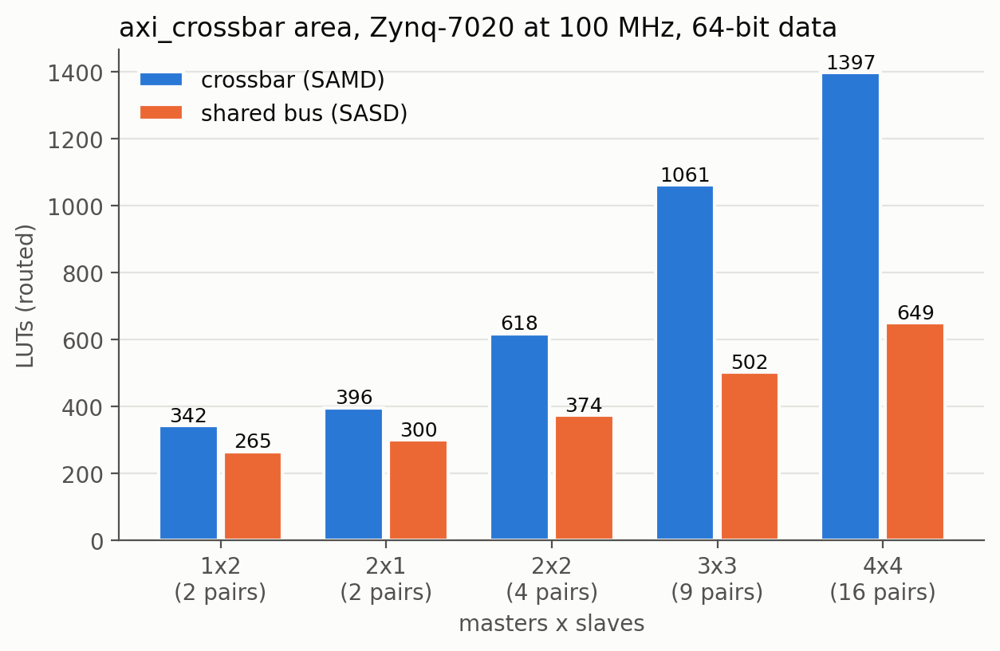

# Area

```bash
(env) python xbar_demo.py --through area
```

prints the area of every shape, routed out of context on the Zynq-7020 at
100 MHz, 64-bit data:

| shape | LUT crossbar | LUT bus | ratio | FF crossbar | FF bus | BRAM |
| --- | --- | --- | --- | --- | --- | --- |
| 1x2 | 342 | 265 | 1.3x | 507 | 230 | 0 |
| 2x1 | 396 | 300 | 1.3x | 377 | 235 | 0 |
| 2x2 | 618 | 374 | 1.7x | 545 | 237 | 0 |
| 3x3 | 1061 | 502 | 2.1x | 769 | 243 | 0 |
| 4x4 | 1397 | 649 | 2.2x | 978 | 251 | 0 |

The shape is masters x slaves: 2x1 is two masters sharing one memory, 1x2
one master reaching two. Every one of them meets timing at 100 MHz with
at least 2.8 ns of slack, so at this clock the choice is about area and
throughput, not about closing timing.



## Reading the table

**The shared bus is almost flat.** Its flip-flops hardly move, 230 to 251,
because it has one set of registers whatever the shape: one transaction
is in flight at a time. Its LUTs grow with the number of ports, since each
master needs a path into the multiplexer and each slave a decoder output,
but slowly: 374 to 649 from 2x2 to 4x4.

**The crossbar grows much faster**, and the gap widens with the shape:
1.3x the bus for the smallest shapes, 2.2x at 4x4. A crossbar keeps
state per master and per slave (which transactions are outstanding, and to
where) and has a data path from every master to every slave. From 2x2 to
4x4 the number of master/slave pairs goes up four times, and the
crossbar's LUTs go up 2.3 times. That understates it: the 4x4 crossbar
also uses 276 **F7 muxes**, which join two LUTs into one wider function
and are not counted as LUTs, while the 2x2 uses none. Counting them,
the 4x4 crossbar is closer to 1,670 LUT-equivalents, 2.7 times the 2x2.

**Slices** are the honest unit of area on this chip: each holds four
LUTs, eight flip-flops and the F7 muxes between them. The 2x2 crossbar
fills 236 slices and the 4x4 523; the bus fills 112 and 212.

**No block RAM.** The FIFOs the IP can insert are off by default, so the
crossbar is all LUTs and flip-flops. On the Zynq-7020, with 53,200 LUTs,
even the 4x4 crossbar is under 3% of the chip. Area matters more for a
larger crossbar, or for a smaller part.

## Measuring one again

The table was measured beforehand, because each crossbar takes about four
minutes in Vivado. To measure one now:

```bash
(env) python xbar_demo.py --through synth                                   # 4x4 crossbar
(env) python xbar_demo.py --through synth --synth-shape 4x4 --synth-mode SASD  # 4x4 bus
```

It prints the new numbers under the cached ones. A second run of the same
crossbar is cached; `--fresh` runs Vivado again.

"Out of context" means the crossbar is synthesized on its own, with no
design around it. The numbers are its own, but inside a full design
Vivado may share or trim some of its logic.
