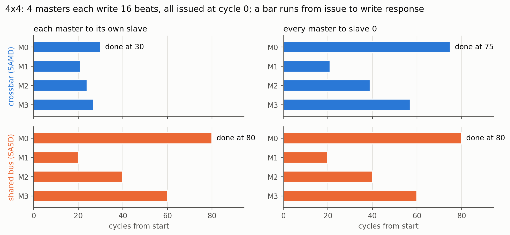
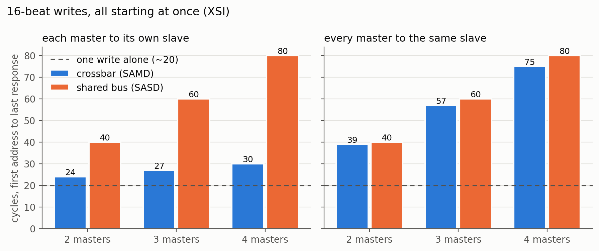

# Latency and Throughput

```bash
(env) python xbar_demo.py
```

simulates the 2x2 and 4x4 crossbars, each in both modes, and runs the
same experiments on each:

| Experiment | What it does |
| --- | --- |
| one write alone | master 0 writes 16 beats to slave 0; nothing else happens |
| each master to its own slave | master *k* writes 16 beats to slave *k*, every *k* at once |
| all masters to one slave | every master writes 16 beats to slave 0 at once |

and the same three for reads. Each count is in clock cycles, from the
first address handshake to the last response. The output:

| shape | mode | LUT | one 16-beat write | each master to own slave | all masters to one slave |
| --- | --- | --- | --- | --- | --- |
| 2x2 | crossbar (SAMD) | 618 | 21 | 24 | 39 |
| 2x2 | shared bus (SASD) | 374 | 20 | 40 | 40 |
| 4x4 | crossbar (SAMD) | 1397 | 21 | 30 | 75 |
| 4x4 | shared bus (SASD) | 649 | 20 | 80 | 80 |

Reads behave the same way: 20 cycles alone on either; 23 and 29 cycles on
the crossbar for 2 and 4 masters to their own slaves, against 40 and 80
on the bus.

## One transfer: the same on both

A 16-beat write alone takes 21 cycles on the crossbar and 20 on the bus:
16 beats of data plus a few cycles to pass the address through and return
the response. A single-beat write takes 6 and 5. **A crossbar does not
make a transfer faster**; if anything it adds a cycle. What it buys is
parallelism.

## Different slaves: the crossbar overlaps them



Each bar runs from when a master issues its write to when its write
response comes back; all four issue at cycle 0.

On the **shared bus** (bottom row) the four writes go one after another,
20 cycles each: 80 cycles for four, whether they go to one slave or to
four. The bus cannot tell the difference, because it carries one
transaction at a time.

On the **crossbar**, writes to different slaves (top left) overlap: all
four are done in 30 cycles, not 80. They do not all finish at 21, though:
they finish 3 cycles apart. The name says why: `SAMD` is *shared address*,
multiple data. The address channel is still one arbiter, which accepts one
master's address every few cycles; only the data paths run side by side.

## The same slave: no help from the crossbar

When every master writes to slave 0 (top right), the crossbar has to
serialize them like the bus does: one slave accepts one burst at a time,
and an AXI4 burst cannot be interleaved with another. The four writes
finish 18 cycles apart: 75 cycles, against 80 on the bus. The crossbar
gains about 2 cycles per master, most likely by accepting the next
address while the previous burst is still finishing, where the bus waits
for the response first.



So the crossbar's advantage depends on the **traffic**, not only on the
hardware: N masters each with its own memory get almost N times the
throughput of a bus, and N masters all using one memory get almost
nothing. That is why a design with one shared DDR, reached through one
port, gains little from a crossbar in front of it, and why designs that
need parallel bandwidth split their data across several memories.

## What the simulation is

`xbar_demo.py` generates each crossbar with Vivado's `create_ip`, then
compiles it with a small Verilog wrapper and runs it in the Vivado
simulator through XSI, driven from C++. Each master is a model that
issues AXI4 bursts at a given cycle and records when its address was
accepted and when its response arrived. Each slave is a memory model that
serves one burst at a time. Every read is checked against what the
matching write stored, so an experiment that moved the wrong data fails
instead of reporting a latency.

The first run compiles each crossbar, about 15 s each; later runs reuse
the compiled simulation and take a second or two. `--fresh` compiles
again. The cycle counts do not depend on the clock, which only matters for
synthesis: the simulation counts cycles of the crossbar's own logic.
